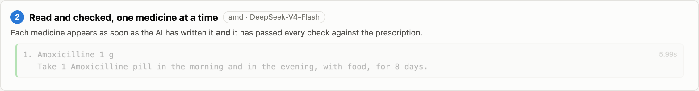
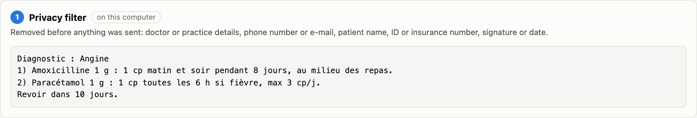
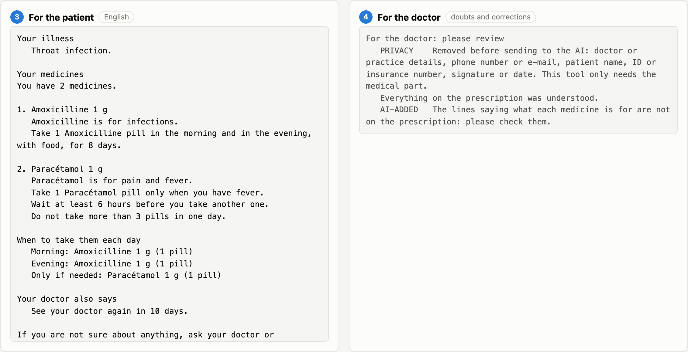
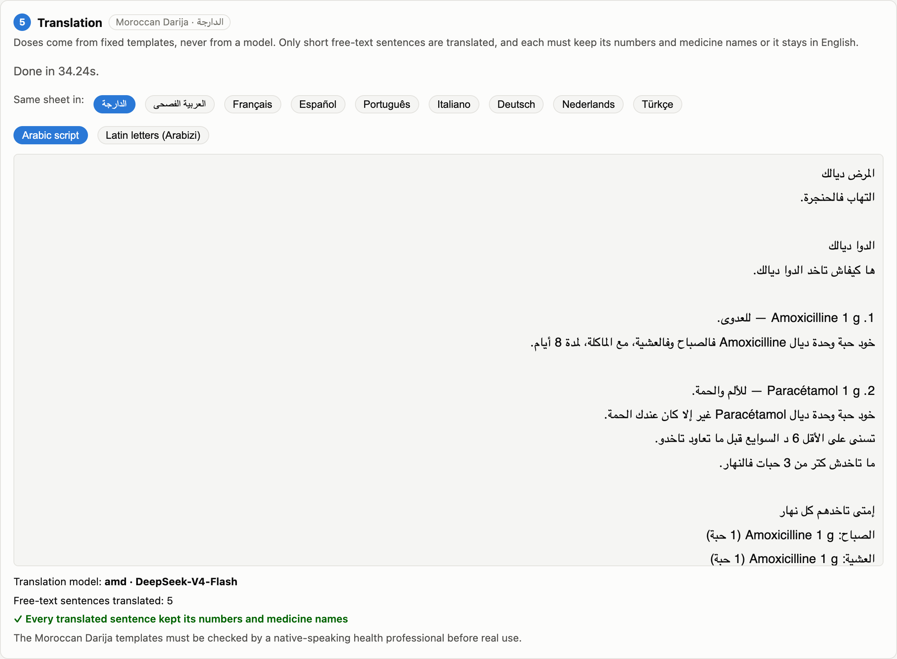
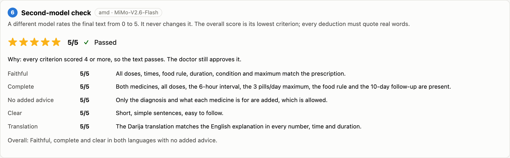
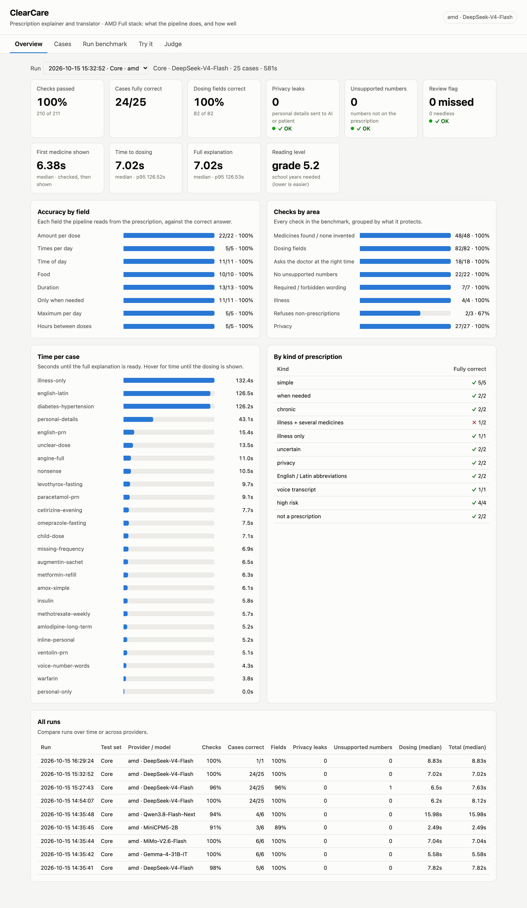

# ClearCare

### Your prescription, explained in your language.

*AMD Developer Hackathon ACT III · Health and Wellbeing track*

Many patients leave the doctor's office with a prescription they cannot really read: shorthand like
`1 cp x 2/j`, Latin abbreviations, a language they do not speak, or simply not reading well. Taking the
wrong amount, at the wrong time, or for too long can hurt them.

**ClearCare** turns the prescription, typed or dictated, into a short, plain sheet: what each medicine
is for, how much to take, when, with or without food, and for how long. In **English and 9 other
languages**: Moroccan Darija (also in Latin letters), Modern Standard Arabic, French, Spanish,
Portuguese, Italian, German, Dutch and Turkish.

- **It only restates the prescription.** No diagnosis, no medical advice.
- **The AI never re-words a dose.** Dose sentences come from fixed templates, and every number is
  checked against the prescription.
- **It says when it is not sure**, and why, instead of guessing.
- **A doctor approves every sheet** before the patient gets it.
- **Private by design.** Names, phone numbers and ID numbers are removed on the device, before
  anything reaches the AI.

Built on **AMD Developer Cloud**: `DeepSeek-V4-Flash` reads and translates, and a second model,
`MiMo-V2.6-Flash`, double-checks every result.

| 210 / 211 | 0 | 6.4 s | 90 % | 10 |
|:---:|:---:|:---:|:---:|:---:|
| benchmark checks passed | privacy leaks | until the first medicine is on screen | planted mistakes caught by the second model | languages |



## How it works

1. **Privacy filter, on this computer** ([privacy.py](privacy.py)): names, ages, phone numbers,
   ID/insurance numbers, dates and the doctor's stamp are removed before anything is sent to an AI.

   
2. **Reading the prescription, one medicine at a time** (AI, compact JSON): illness, and for each
   medicine the amount, times of day, food, duration, "only when needed", maximum per day. The answer
   is streamed: each medicine is shown as soon as the AI has written it **and** it has passed every
   check, so the first one is on screen in about 6 seconds.
3. **Checks against the original text** (code, not AI): every number must be on the prescription,
   tablet/capsule as written, food rules and follow-up visits must be written, missed details are
   re-read from the medicine's own line, a medicine name that is not on the prescription is never
   shown, and unknown medicine names are said to be unknown instead of guessed. Nothing is fixed or
   removed silently.
4. **Plain sentences built from templates** (code), so a dose cannot change while being "reworded".
5. **Uncertainty is visible**: the patient gets an apology with the reason ("Sorry, I am not sure
   about how much to take. Why: the amount is not written on the prescription"); the doctor gets a
   review box listing every doubt and correction.

   
6. **Translation** ([translation-pipeline/](translation-pipeline)): dose sentences come from fixed
   templates written for each language ([languages.py](translation-pipeline/languages.py)); only short
   free text (what a medicine is for, the illness, the doctor's notes) is translated by the AI, and a
   translated sentence that changes a number or a medicine name stays in English and is reported.
   Darija can also be shown in Latin letters (Arabizi).

   
7. **Second-model check** ([judge.py](translation-pipeline/judge.py)): a different model rates the final
   text from 0 to 5 on faithful, complete, no added advice, clear and translation. Every deduction must
   quote real words; the overall score is the lowest criterion. It never changes the text.

   
8. **Doctor approval**: approve, edit or reject. Only approved text is saved for the patient,
   stamped "Checked by your doctor".

## Results

Core benchmark, 25 labelled prescriptions, `DeepSeek-V4-Flash` on AMD:

| | |
|---|---|
| Checks passed | **210 / 211** (the one miss: the AMD service timed out; the case passes 14/14 when run again, and a timeout now falls back to a normal request) |
| Every dosing field (amount, times, food, duration, "only when needed", maximum, hours apart) | **100 %** |
| Privacy leaks | **0** |
| Numbers that are not on the prescription | **0** |
| Doctor review flag | **0 missed, 0 needless** |
| First medicine on screen | **6.4 s** (median) |
| Reading level | grade 5.2 |

Judging the judge (correct explanations with one planted mistake each, `MiMo-V2.6-Flash`):

| | |
|---|---|
| Planted mistakes caught (score ≤ 2, right criterion, reason names the mistake) | **28 / 31 (90 %)** |
| False alarms on correct explanations | 1 / 5 |
| Reasons quoting words that are not in the text | 2 in 36 ratings |

Weak spot: a removed "only when needed" is caught 1 time in 4. The pipeline's own code checks
"only when needed" against the prescription (11/11 in the benchmark), and the doctor approves every
sheet. The list of French prescription words in the judge's instructions was added after seeing its
first mistakes ("au milieu des repas" read as "between meals"); both runs are kept in
`translation-pipeline/data/`.



## Run it

```bash
./install.sh          # creates the venv, the settings file (.env) and the `rx` command
rx                    # interactive: paste a prescription, press Enter twice
rx -f examples/angine.txt
rx -p ollama          # free local model; default provider is set in .env
```

Providers: `amd` (AMD Developer Cloud, model `DeepSeek-V4-Flash`), `ollama` (local), `openrouter`.
API keys go in `.env` (never in the code; `.env` is not in the repository).

```bash
cd translation-pipeline
.venv/bin/python translation_pipeline.py -f ../examples/angine.txt --lang fr     # ary ar fr es pt it de nl tr
.venv/bin/python judge_eval.py                                                    # judge the judge
```

Dashboard: `AMD Full stack/run.sh`, then http://localhost:8000 (benchmark results, live runs,
"Try it" step by step with translation and judge, and every judge result explained).

## Patient and consultation app (Streamlit)

A separate Streamlit workspace adds **Patients → Patient history → Consultation** around
this existing agent, with SQLite records, versioned doctor approval, PDF/text export,
optional email and audio. No FastAPI service is required, and the AI pipeline is unchanged.

```bash
./run_streamlit.sh  # local workspace on http://127.0.0.1:8501
```

Configure the existing provider in `.env`. See [app setup and workflow](clearcare_app/README.md)
for language support, optional SMTP/patient links, storage, deployment boundaries and tests.
The benchmark dashboard remains available separately.

## Measuring it

```bash
.venv/bin/python -m benchmark.run --cases cases.jsonl        # core set (25 cases)
.venv/bin/python -m benchmark.run --cases realworld.jsonl    # messy real-world prescriptions (24)
.venv/bin/python -m benchmark.generate --seed 7 -n 40         # random prescriptions with exact answers
.venv/bin/python -m benchmark.run --cases random_seed7.jsonl
.venv/bin/python -m benchmark.run --cases pxcorpus.jsonl --no-purpose   # 1,981 real spoken prescriptions
.venv/bin/python -m benchmark.compare_models -p amd           # speed and accuracy of every AMD model
```

`pxcorpus.jsonl` is built by `benchmark/pxcorpus.py` from **PxCorpus** (Kocabiyikoglu et al., LREC 2022,
[Zenodo](https://zenodo.org/records/6482587), CC BY 4.0): real French drug prescriptions dictated by doctors,
medical practitioners and non-experts, with human annotations. The model only receives the transcript; the
annotations are used by the scorer alone.

Each run scores field accuracy, medicines found or invented, illness, review flags, privacy
leaks, numbers that are not on the prescription, speed and reading level, and is saved in
`benchmark/results/`.

## Before real use

The sentence templates of every language must be checked once by a native-speaking health
professional. The medicine name list (`data/medicine_names.txt`) should be replaced by the national
drug register.

## Files

| File | What it does |
|---|---|
| `ai_pipeline.py` | The pipeline: privacy, streamed reading, checks, rendering (`stream_prescription()`) |
| `privacy.py` | Local removal of personal details |
| `doctor_cli.py` | Terminal tool for doctors, with review and approval |
| `translation-pipeline/` | Translation (9 languages, `languages.py`), the judge and its tests |
| `benchmark/` | Test sets, random generator, scorer, model comparison |
| `AMD Full stack/` | Web dashboard (`./run.sh`, then http://localhost:8000) |
| `data/medicine_names.txt` | Known medicine names (unknown names are flagged, never guessed) |
| `docs/screenshots/` | Screenshots |
| `examples/` | Example prescriptions |
